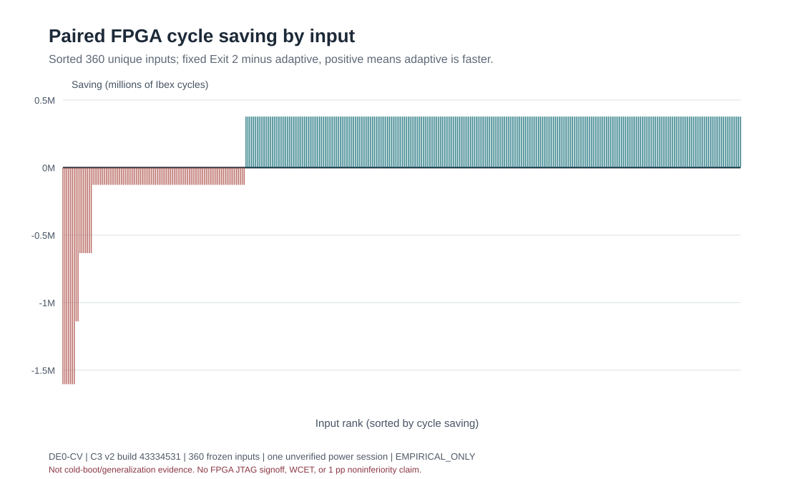
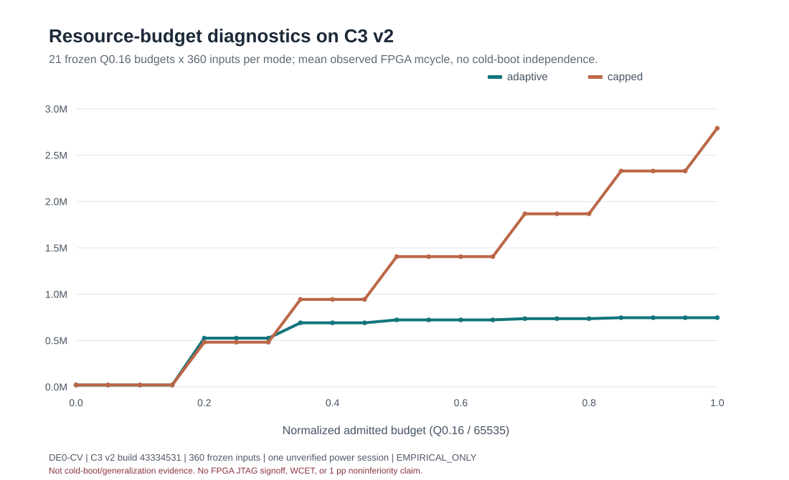

# Resource-Conditioned Neural Inference on a Cyclone V FPGA: An Exact-Build Empirical Case Study

**Working manuscript for technical review — 17 November 2026.** This is a draft of an empirical case study, not a claim of hard-real-time certification. No author names, venue, or accepted-paper status have been assigned.

## Abstract

A neural classifier with conditional early stopping can trade computation for resource availability, but nominal operation counts do not by themselves establish physical latency or worst-case execution-time guarantees. We study a frozen, same-parameter Q15 classifier deployed to an Ibex soft processor on a Terasic DE0-CV Cyclone V FPGA. A continuous normalized budget interface is conservatively mapped to seven finite maximum-work classes; the adaptive policy may stop before its admitted ceiling. We distinguish exact-build measurements from formal physical timing guarantees. In the C3 v2 build, a 64-bit Ibex cycle-counter protocol, model/build identifiers and response checks were used to archive 24,840 successful requests over 13 frozen schedules using 360 distinct held-out inputs. The ten primary schedules contain 3,600 fixed-Exit-2/adaptive input pairs, **all at maximum Q0.16 budget (65535) with no deadline**; the fixed-2 comparator was selected with prior test results known. Separately, 17,640 diagnostic requests sweep seven fixed classes and 21 budgets for adaptive and capped modes. The fixed and adaptive modes averaged 943,929.77 and 746,327.99 Ibex cycles, respectively: a **20.934% observed mean reduction** (197,601.77 cycles). A 5,000-replicate, input-ID-cluster bootstrap yields a conditional 95% interval of 16.804%–24.903%. The adaptive mode was faster on 263/360 distinct inputs but slower on 97/360; both modes produced 339/360 correct labels. The paired accuracy-difference bootstrap interval of −1.389 to +1.389 percentage points does **not** establish the prespecified one-point noninferiority condition. All ten primary repeats had identical cycle counts for each input/mode, but they are not independently verified power sessions. Moreover, external onboard JTAG I/O timing is unconstrained, and the identified CDC structures retain review findings. Our results establish bounded-scope, exact-build **empirical** cycle savings and correct functional protocol behavior; they do not establish deployment-wide speed superiority, accuracy noninferiority, deadline guarantees, or worst-case execution time (WCET).

**Keywords:** conditional computation; early exiting; Q15; Ibex; FPGA; exact-artifact reproducibility; empirical cycle accounting; real-time systems.

## 1. Introduction

Resource-adaptive neural execution is useful when additional internal computation has diminishing value and available resource or deadline changes at run time. Earlier work on early exits and conditional routing established several ways to reduce expected computation [1–3]. A hardware claim, however, requires distinguishing *executed neural work*, *software/RTL execution cycles*, *I/O transfer latency*, and *a proof of a deadline bound*. An instruction-count approximation, a host-side time percentile, or a positive FPGA internal-clock slack report alone cannot fill these different evidentiary roles.

This study evaluates one exact build of the repository's resource-conditioned RTNN prototype on one Cyclone V board. It uses the same frozen seed-63 Q15 parameter set under a finite maximum-work ceiling, rather than training a separate model for each budget. The contribution is a bounded, artifact-linked empirical case study and its reproducibility audit; we do not claim that early exit, budgeted computation, entropy-based decisions, or FPGA early-exit inference are new mechanisms. The case-study contributions are:

1. A 24,840-row empirical JTAG acquisition audit tied to one C3 v2 SOF, one firmware ELF, one model identity, 13 frozen schedules and original raw request/response traces.
2. An independently recomputed, input-paired cycle comparison with explicit *input-level* statistical uncertainty, observed failure modes (late exits), and a separate accuracy-noninferiority verdict.
3. A matched previous-build audit that found an exact **+5 Ibex-cycle difference for all 7,200 primary rows** while preserving the output prediction and admitted/executed exits; the cause remains unresolved.
4. An explicit boundary between empirical function/cycle evidence and incomplete onboard JTAG timing/CDC signoff.

These observations are not offered as an original theorem of universal WCET or as an exhaustive comparison with all adaptive-computation systems.

### Prior work and novelty scope

Input-dependent early exits and resource-aware execution predate this study. BranchyNet adds intermediate classifiers and exits when confidence is sufficient [1]. MSDNet explicitly studies anytime prediction and budgeted batch classification with a single multi-exit model [2]. SkipNet learns per-input routing that skips residual blocks [3], and EENet learns exit policies under an average inference budget [5]. Entropy-based early exit on low-precision FPGA hardware was also reported by Kong and Nunez-Yanez [6]; a separate FPGA system adapts processing rate using output entropy [7]. FPGA implementation of dynamic early-exit DNNs, including pipeline and parallel hardware approaches, was evaluated on a ZCU106 in 2025 [8]. Consequently, this paper makes no algorithmic novelty or first-FPGA-early-exit claim. Its limited contribution is the traceable measurement and audit of a particular frozen Q15/Ibex softcore build on a DE0-CV, with request-level JTAG result identity and `mcycle` accounting.

Timing predictability is a separate literature and claim. Pearce et al. compile a neural-network controller into analyzable C for the time-predictable Patmos processor and derive execution bounds [9]. Zhang et al. present static timing analysis for CNN inference on FPGA SoCs with shared multi-DPU engines [10]. The present work provides neither comparable static analysis nor a hard execution bound; its reported cycle counts are empirical and exact-build-specific.

## 2. System and frozen artifact identity

The target is a Terasic DE0-CV with a Cyclone V **5CEBA4F23C7N**, an Ibex RV32 softcore, and FPGA-resident code/data for the selected build. The observed physical counter is the Ibex `mcycle` CSR, **not** a wall-clock stopwatch. The synthesis/STA design declares a 50 MHz system clock; no measured oscillator calibration or absolute inference-time claim is made. Quartus Prime Lite **25.1std.0 Build 1129** and Verilator-based simulations are recorded in the source evidence.

The same Q15 neural parameters are used under two relevant execution choices: fixed Exit 2 and input-adaptive execution. The public budget admits a maximum-work class; optional neural blocks are not required to run simply because the maximum grant is large. The hardware-protocol response includes prediction, executed class, admitted class, request/response identity, checksums, and 64-bit start/end cycle samples. The timer samples bracket the firmware's inference/admission path and exclude the host's JTAG scan and wait operations.

| Immutable item | C3 v2 primary empirical build |
|---|---|
| Build / binding ID | `43334531` |
| Model ID | `52544e4e` |
| SOF SHA-256 | `85c5fd086cf83c5a897f3de1bba1d3dd0c0a5c06a53eb492a23e5160fb3f1f2d` |
| Firmware ELF SHA-256 | `9cbf537bd9440deaf5c78abf6b204da9cbcd2fe3795acf444d733dbd581002b6` |
| Frozen campaign SHA-256 | `d6c98f59c0c0afe32d0877c01c8411fba8bf3e2a5c8058c5a85371f7f648a8dc` |
| Q15 weight header SHA-256 | `961a76b7e220bf2f665e7c04ab62063600aa2e7eccf3403d80ea730bc993ad9f` |
| Prior C2J2 build / SOF SHA-256 | `43324a32` / `5aa5be2e7387e22e43db6a322e1572cceacd3266231af4dbc2de01ee649c37e6` |

The previous C2J2 build is analyzed only as a **separate frozen-artifact comparator**; no raw rows from its campaign are pooled into C3 v2 estimates.

## 3. Evaluation design and reproducible methods

### 3.1 Frozen schedules and grain

The archived campaign contains **13 schedules / 24,840 requests**: diagnostic fixed 2,520, diagnostic adaptive 7,560, diagnostic capped 7,560, and ten primary schedules × 720 rows = 7,200. The evaluation uses **360 distinct input IDs**, not 24,840 independently sampled images. Each primary schedule includes every ID once under fixed Exit 2 and once under the corresponding adaptive policy. No schedule, target label or model weight was changed for this reanalysis.

**Dataset and model provenance.** The frozen input set is drawn from `sklearn.datasets.load_digits` [4], which scikit-learn documents as a copy of the UCI handwritten-digits test set: 8×8 grayscale images with 64 integer pixel intensities in 0–16 and 10 classes [11]. The UCI record identifies Alpaydin and Kaynak (1998), DOI 10.24432/C50P49, and licenses the dataset under CC BY 4.0 [12]. The archived metadata name scikit-learn 1.8.0 and a stratified 60/20/20 train/validation/test split using random states 123 and 456; 360 test examples are indexed by a frozen `source_index`, `input_id` and true label. For any redistribution of the derived input bytes, retain UCI attribution and the CC BY 4.0 notice; the scikit-learn software license is a separate matter. The model recipe uses eight row tokens per image, a 16-dimensional embedding, six optional 2-head self-attention/MLP blocks (MLP width 32) and seven classifier exits (0–6). The evaluated seed-63 Q15 weights, firmware and input bytes are frozen, not trained for this reanalysis. These particulars are documented in `C3/frozen_inputs/generated/heldout360.json` and `experiments/realtime_nn_real_sequence_generalization.py`; a float-model training recipe is not by itself proof of bit-identical Q15 deployment.

**Selection and protocol limits.** The frozen `campaign.json` explicitly says `prior_test_results_known=true` and describes fixed Exit 2 as `previously_observed_comparator_not_test_blind_selection`. This study is therefore *not* a new test-blind generalization experiment. All **7,200 primary** runs use full budget `budget_q16=65535` and `deadline_cycles=0`; their 20.934% saving concerns entropy/policy-driven conditional stopping relative to fixed Exit 2 at maximum budget, *not* a comparison across varying budgets or enforced deadlines. Separate **secondary diagnostic** schedules perform the 21-point Q0.16 budget sweep in adaptive and capped modes (7,560 rows each) and the seven fixed-exit levels (2,520 rows).

For each primary request we checked: exactly one sequence, valid build/SOF/model/binding identity, response-to-request input/mode/sequence identity, CRC, frozen expected prediction and executed/admitted exits, valid positive cycles, and correct 64-bit counter subtraction. The 13-schedule aggregate evidence audit additionally checks all frozen run counts and hashes. A separate C2J2 comparison uses only frozen rows with the same input, mode and primary schedule.

### 3.2 Variables, estimands and unit check

| Symbol | Meaning (日本語) | SI unit | Definition and domain | Type |
|---|---|---|---|---|
| `i` | 凍結評価入力ID | 1 (dimensionless) | integer 0–359; one held-out input | discrete scalar |
| `s` | 凍結primaryスケジュール | 1 | integer 1–10, all within the same unverified power-session context | discrete scalar |
| `N` | 独立評価入力数 | 1 | 360, fixed by the frozen evaluation set | positive integer scalar |
| `C_F,i,s` | 固定Exit 2の実行サイクル数 | 1 (count of cycles) | positive Ibex `mcycle` delta for input `i`, schedule `s` | integer scalar |
| `C_A,i,s` | 適応実行サイクル数 | 1 (count of cycles) | positive Ibex `mcycle` delta for same input/schedule | integer scalar |
| `F_i` / `A_i` | 入力ごとの固定／適応平均cycle | 1 (count of cycles) | average of the ten corresponding primary schedules | real scalar |
| `D_i` | 入力別のcycle削減量 | 1 (count of cycles) | `F_i − A_i`, can be negative | real scalar |
| `R` | 固定平均に対する平均削減比 | 1 (dimensionless) | ratio of mean paired saving to mean fixed cycles | real scalar |
| `Y_i` | 真の分類ラベル | 1 | frozen handwritten-digit class, 0–9 | discrete scalar |
| `P_F,i`, `P_A,i` | 固定／適応の予測ラベル | 1 | frozen classifier prediction, class 0–9 | discrete scalar |

The paired sample estimands are

\[
D_i=F_i-A_i,\qquad
\bar D=\frac{1}{N}\sum_{i=0}^{N-1}D_i,\qquad
R=\frac{\bar D}{\frac{1}{N}\sum_{i=0}^{N-1}F_i}.
\]

**Dimensional check:** both `F_i` and `A_i` are counts of CPU clock cycles (SI dimension 1), hence `D_i` and `\bar D` are also counts; the ratio `R` is dimensionless. No uncalibrated CPU-clock setting was turned into an SI time measurement.

Uncertainty intervals resample the **360 input IDs**, holding the ten planned primary observations together within each ID (Python `random.Random(63)`, 5,000 replicates, linearly interpolated percentile endpoints). They do not resample independent board boots because independent cold boots were **not established**. Accuracy is compared on the same 360 labels, using paired correctness indicators rather than treating repeats as new labels.

## 4. Results

### 4.1 Archive integrity and the empirical cycle contrast

The C3 v2 aggregate archive reports **13/13 successful schedules and 24,840/24,840 requests**, with the response checks passing under the saved source identity. This reanalysis independently parsed all ten primary CSVs (7,200 rows), checked the published per-session SHA-256 values against the aggregate manifest and found no mismatches in required identity, expectation or 64-bit interval fields.

| Primary result | Frozen C3 v2 observation |
|---|---:|
| Unique input IDs / paired schedule observations | 360 / 3,600 |
| Fixed Exit 2 mean | **943,929.77 cycles** |
| Adaptive mean | **746,327.99 cycles** |
| Fixed2 minus adaptive mean | **197,601.77 cycles** |
| Observed mean reduction | **20.93395%** |
| 95% input-only bootstrap CI, absolute saving | **158,616.47 to 235,071.07 cycles** |
| 95% input-only bootstrap CI, reduction | **16.80384% to 24.90345%** |
| Unique inputs faster / slower with adaptive execution | **263 / 97** |
| Primary input-mode pairs with different cycle counts across ten schedules | **0 / 720** |

The 5% practical reduction point estimate and input-only CI threshold are met **conditional on the recorded session**. The original study's independent-power-session requirement is not met, so we explicitly **withhold a confirmatory speed-superiority claim**.



### 4.2 Early stopping saves work for many, but not all, inputs

The adaptive executed Exit histogram over the 360 unique IDs is:

| Executed Exit | Unique inputs | Mean adaptive cycles |
|---:|---:|---:|
| 1 | 263 | 565,955.62 |
| 2 | 81 | 1,071,501.64 |
| 3 | 7 | 1,577,048.14 |
| 4 | 2 | 2,082,594.00 |
| 5 | 7 | 2,547,941.71 |

Fixed Exit 2 averages 943,929.77 cycles. The adaptive policy's late Exit 2–5 cases therefore have higher observed cycles than the fixed-2 baseline in this artifact. A prototype that saves arithmetic on most inputs can nevertheless incur a material tail on hard inputs. This exit-stratified finding is descriptive: it does **not** identify what *caused* the per-image stopping decision.


Figures 1–3 in this draft are original SVGs regenerated from archived experiment CSVs by the repository's primary and diagnostic analysis scripts. They are not reproductions of third-party figures; their raw-data and output SHA-256 values are recorded in the corresponding run manifests.

### 4.3 Resource-budget sweep: secondary diagnostic evidence

The main 20.934% figure is a full-budget primary comparison and cannot alone demonstrate a response to changing budget. We therefore separately reanalyzed the **17,640 frozen diagnostic requests**, joining each result to its frozen matrix by sequence and input ID: seven fixed exits × 360 inputs, 21 budgets × 360 adaptive inputs and 21 budgets × 360 capped inputs. All stored build/SOF/binding IDs, expected Q15 labels/exits, CRC fields, mcycle differences and resource caps matched; no violation was detected in this diagnostic subset.

| Budget Q0.16 | Approximate normalized budget | Adaptive mean cycles | Adaptive correct / 360 | Capped mean cycles | Capped correct / 360 |
|---:|---:|---:|---:|---:|---:|
| 0 | 0% | 20,210.91 | 171 | 20,155.91 | 171 |
| 32,768 | 50% | 722,856.33 | 340 | 1,405,822.76 | 338 |
| 65,535 | 100% | 746,327.99 | 339 | 2,791,492.77 | 333 |

This table demonstrates that *this implementation's observed cycle count changes with admitted budget*. At the maximum budget, the adaptive policy's entropy stopping greatly reduces mean cycles relative to the capped full-work mode; however, the capped full-work mode is **not** the fixed-Exit-2 primary comparator. Neither the adaptive nor capped model's accuracy is guaranteed to rise monotonically with budget: the archived diagnostic counts illustrate this tradeoff rather than a superiority test. These budget-sweep comparisons are **secondary, descriptive, same-sample** evidence with no independent power-session replication. They are not deadline-admission guarantees or a blind hyperparameter study.



### 4.4 Accuracy remains a separate unresolved claim

Both configurations classify **339/360 (94.167%)** held-out inputs correctly. The paired contingency is **336 both-correct, 3 fixed-only-correct, 3 adaptive-only-correct and 18 both-wrong**. Their observed accuracy difference is 0.000 percentage points. The input-paired percentile-bootstrap 95% interval is **[−1.389, +1.389] percentage points**. Because its lower bound is below the prespecified −1.0-point noninferiority margin, **1-point accuracy noninferiority is INCONCLUSIVE**, not PASS. Replaying the same 360 inputs cannot close this inferential gap merely by producing more JTAG requests.

### 4.5 A separately identified +5-cycle build difference

We matched all ten primary C2J2 CSVs against the corresponding C3 v2 CSVs by schedule, sequence, input ID and mode. Across **all 7,200** paired rows, the C3 v2 cycle count exceeded C2J2 by **exactly five cycles**, while every prediction, admitted Exit and executed Exit matched. The mean cycle **difference** between fixed and adaptive is consequently unchanged across builds; the fractional reduction changes slightly because both denominators shift.

The C3 v2 firmware explicitly stores a 64-bit `cycles_start` value within the measured boundary, unlike the old C2J2 elapsed-counter response path. This is a **plausible implementation-level contributor** to the constant shift. A cycle-accurate instruction-trace or compiler artifact comparison is still required before attributing all five cycles causally to that store. The five-cycle effect is an **observed cross-build offset, not a universal correction factor**.

### 4.6 Why identical schedule repeats do not establish boot independence

For every input and each execution mode, the `mcycle` delta is exactly identical over all ten primary schedules (360/360 input IDs, both modes). This supports a deterministic cycle path under the saved board/build/session conditions. It does **not** establish ten independent realizations of clock, power-on reset, temperature, placement, or board-to-board variability. A previously attempted power-cycle study left the USB-Blaster connected, making full FPGA rail discharge uncertain. The current C3 v2 schedule metadata explicitly mark `cold_boot_confirmed=false`.

## 5. Implementation, reproducibility and timing-assurance limits

The case study uses a known FPGA SOF, firmware ELF, source hashes and frozen schedule files rather than relying only on a training seed. The C3 v2 compile, native and converted RTL regressions, four-corner internal STA and finite CDC phase-stress tests are archived. Preserved reports include positive worst constrained setup slack (+1.803 ns) and hold slack (+0.124 ns), but **external TDI/TMS/TDO paths are not completely constrained** for the on-board FT245BL/EPM240 USB-Blaster controller. The Quartus Design Assistant still identifies **16 D102 CDC structures**. A finite digital simulation and a bundled-data route-delay screening analysis cannot prove analog metastability immunity, external JTAG sampling validity under all conditions, or WCET.

The exact native source graph is now reproducible from a fresh clone of the public research branch using the committed source-mapping helper and the separately pinned Ibex dependency. On commit `6e07b86b9cc0a9384ba88177e06ec5afb34b218b`, the helper verified **146/146** frozen source hashes (141 files from Ibex commit `7b5df75a041affe56e8c235260f98a09b3319008`, plus five byte-exact project-source variants archived in the repository), then the native Verilator regression passed its 42 scheduled requests, reset-recovery cases, negative cases, and response-write guard. This establishes reproducibility of the mapped native simulation graph from that public branch snapshot; it does **not** establish a Quartus-identical rebuild, SOF/ELF identity, board timing signoff, or WCET. The 2026-11-21 145/146 audit remains as a correct historical result for its earlier source map. See the [clean-clone run record](CLEAN_CLONE_REGRESSION_RUN_RECORD_20261122_JA.md) and [source recovery addendum](SOURCE_RECOVERY_ADDENDUM_20261122_JA.md).

We therefore distinguish:

- **PASS, recorded empirical data integrity:** run IDs, source identities, 64-bit counter differences, frozen predictions and executed exits for the audited archive.
- **Conditional numerical summary:** input-level saving under the observed single-board/session context.
- **INCONCLUSIVE accuracy noninferiority:** the prespecified 1-point margin is not established.
- **UNCERTAIN independent boot variability:** independent full power sessions were not verified.
- **BLOCKED formal board timing signoff:** external on-board JTAG timing constraints and complete CDC assurance are missing.

The reported finite counts are not thermal/power measurements, wall-clock latency, energy efficiency, or a theorem of hard deadline feasibility.

## 6. Conclusion and prioritized validation plan

For one identified DE0-CV/soft-Ibex/Q15 build, **adaptive early stopping at maximum admitted budget** was observed to use **20.934% fewer mean inference cycles** than an earlier, non-test-blind fixed Exit 2 comparator over 360 frozen evaluation inputs, with positive saving for 263 inputs and increased cost for 97. A separately archived 21-budget secondary diagnostic sweep supports the narrower statement that admitted budget changes the observed computation and can change accuracy; it is not evidence that the primary 20.934% saving holds at every budget. It retained the same aggregate correct-label count, while not establishing the prespecified 1-point noninferiority bound. The complete 24,840-row trace packet supports an exact-artifact case study, not a cross-board timing certificate.

The most valuable follow-up is to secure reproducible independent power sessions and a larger, prospectively frozen held-out sample if the authors seek confirmatory speed or accuracy claims. Formal board-level timing assurance should be treated as a separate research gate requiring board-specific controller timing data and defensible measurement uncertainty; no oscilloscope should be connected without verified safe probe points. For the present work, manuscript/evidence consistency and a portable source dependency manifest take precedence over repeating the same uninformative measurement.

## Evidence and reproducibility

The claim-to-artifact limitations are summarized in [`CLAIM_EVIDENCE_MATRIX.csv`](CLAIM_EVIDENCE_MATRIX.csv), and a post-hoc, descriptive budget Pareto analysis is in [`PARETO_INTERPRETATION_JA.md`](PARETO_INTERPRETATION_JA.md). The related-work scope and novelty limits are documented in [`PRIOR_ART_COMPARISON.md`](PRIOR_ART_COMPARISON.md) and [`NOVELTY_VERDICT_JA.md`](NOVELTY_VERDICT_JA.md).

The primary evidence is internal to the publicly readable repository:
- [C3 v2 full campaign run record](../evidence/PHYSICAL_C3_V2_20261115/FROZEN_CAMPAIGN/RUN_RECORD_JA.md)
- [C3 v2 aggregate run audit](../evidence/PHYSICAL_C3_V2_20261115/FROZEN_CAMPAIGN/C3V2_CAMPAIGN_AGGREGATE_AUDIT_20261115.json)
- [Prior C2J2 historical campaign](../C3_FULL_CAMPAIGN_RUN_RECORD_JA.md)
- [Source/readiness limitations](../C3_CURRENT_STATUS_20261115_OFFLINE_COMPLETION_JA.md)
- [C3 v2 firmware runner](../source/measurement_protocol_v2_43334531_20261115/firmware/rtnn_experiment_runner.c)
- [C2J2 firmware runner](../source/recovered_c2_firmware_43324a32_20261115/firmware/rtnn_experiment_runner.c)

Run this repository-contained, standard-library-only analysis with a new output directory:

```bash
python3 artifacts/experiments/de0_cv_c1_c2_audit_20261114/C3/paper_20261117/reanalyze_c3v2_primary.py --out-dir /tmp/rtnn-c3v2-paper-repro-unique
```

The script checks the 13-schedule manifest totals, hashes all ten C3 v2 primary CSVs, parses their 7,200 result rows, validates 64-bit counter differences and Q15 reference fields, matches 7,200 old-build comparison rows, and writes input-level data, figures and analysis with a SHA-256 manifest. No board, Quartus, Internet, root privileges or statistical third-party packages are required once the source repository has been obtained. The frozen source data are not modified.

## References

1. S. Teerapittayanon, B. McDanel, H. T. Kung. "BranchyNet: Fast Inference via Early Exiting from Deep Neural Networks." *International Conference on Pattern Recognition* (ICPR), 2016. DOI: [10.1109/ICPR.2016.7900006](https://doi.org/10.1109/ICPR.2016.7900006); arXiv: [1709.01686](https://arxiv.org/abs/1709.01686).
2. G. Huang, D. Chen, T. Li, F. Wu, L. van der Maaten, K. Q. Weinberger. "Multi-Scale Dense Networks for Resource Efficient Image Classification." *International Conference on Learning Representations* (ICLR), 2018. arXiv: [1703.09844](https://arxiv.org/abs/1703.09844).
3. X. Wang, F. Yu, Z.-Y. Dou, T. Darrell, J. E. Gonzalez. "SkipNet: Learning Dynamic Routing in Convolutional Networks." *European Conference on Computer Vision* (ECCV), 2018. arXiv: [1711.09485](https://arxiv.org/abs/1711.09485).
4. F. Pedregosa et al. "Scikit-learn: Machine Learning in Python." *Journal of Machine Learning Research* 12(85):2825–2830, 2011. [JMLR paper](https://www.jmlr.org/papers/v12/pedregosa11a.html); [load_digits dataset documentation](https://scikit-learn.org/stable/modules/generated/sklearn.datasets.load_digits.html).
5. F. Ilhan, K.-H. Chow, S. Hu, T. Huang, S. Tekin, W. Wei, Y. Wu, M. Lee, R. Kompella, H. Latapie, G. Liu, L. Liu. "Adaptive Deep Neural Network Inference Optimization with EENet." *IEEE/CVF Winter Conference on Applications of Computer Vision* (WACV), 2024. DOI: [10.1109/WACV57701.2024.00140](https://doi.org/10.1109/WACV57701.2024.00140); [author-version paper](https://openaccess.thecvf.com/content/WACV2024/papers/Ilhan_Adaptive_Deep_Neural_Network_Inference_Optimization_With_EENet_WACV_2024_paper.pdf).
6. M. Kong, J. L. Nunez-Yanez. "Entropy-Based Early-Exit in a FPGA-Based Low-Precision Neural Network." *Applied Reconfigurable Computing*, 2022, pp. 72–86. DOI: [10.1007/978-3-031-19983-7_6](https://doi.org/10.1007/978-3-031-19983-7_6); [institutional postprint](https://liu.diva-portal.org/smash/get/diva2%3A1709087/FULLTEXT02.pdf).
7. E. Y. L. Kwan, J. Nunez-Yanez. "Entropy-Driven Adaptive Filtering for High-Accuracy and Resource-Efficient FPGA-Based Neural Network Systems." *Electronics* 9(11), 1765, 2020. DOI: [10.3390/electronics9111765](https://doi.org/10.3390/electronics9111765).
8. A. Dimitriou, L. Xun, J. S. Hare, G. V. Merrett. "Realization of Early-Exit Dynamic Neural Networks on Reconfigurable Hardware." *IEEE Transactions on Computer-Aided Design of Integrated Circuits and Systems* 44(6):2195–2203, 2025. DOI: [10.1109/TCAD.2024.3519055](https://doi.org/10.1109/TCAD.2024.3519055); [institutional accepted manuscript and record](https://eprints.soton.ac.uk/499024/).
9. H. Pearce, X. Yang, P. S. Roop, M. Katzef, T. B. Strøm. "Designing Neural Networks for Real-Time Systems." *IEEE Embedded Systems Letters* 13(3):94–97, 2021. DOI: [10.1109/LES.2020.3009910](https://doi.org/10.1109/LES.2020.3009910); [arXiv:2008.11830](https://arxiv.org/abs/2008.11830).
10. W. Zhang, Y. Yu, X. Jiang, N. Guan, N. Zhan, L. Ju. "WCET Estimation for CNN Inference on FPGA SoC With Multi-DPU Engines." *IEEE Transactions on Parallel and Distributed Systems* 36(6):1146–1160, 2025. DOI: [10.1109/TPDS.2025.3555968](https://doi.org/10.1109/TPDS.2025.3555968); [institutional publication record](https://scholars.cityu.edu.hk/en/publications/wcet-estimation-for-cnn-inference-on-fpga-soc-with-multi-dpu-engi/).
11. Scikit-learn developers. "Optical recognition of handwritten digits dataset (`load_digits`)." [Official dataset documentation](https://scikit-learn.org/stable/modules/generated/sklearn.datasets.load_digits.html). The loader documents this as a copy of the UCI test data, not MNIST.
12. E. Alpaydin and C. Kaynak. "Optical Recognition of Handwritten Digits" [Dataset]. UCI Machine Learning Repository, 1998. DOI: [10.24432/C50P49](https://doi.org/10.24432/C50P49). License: [CC BY 4.0](https://creativecommons.org/licenses/by/4.0/); [official UCI dataset record](https://archive.ics.uci.edu/dataset/80/optical%2Brecognition%2Bof%2Bhandwritten%2Bdigits).

**Review status:** Numerical claims and archive identities in Sections 3–4 are subject to the included, executable independent reanalysis. This draft is **not publication-ready until the paper's claimed scope, all source links, data license/citation, and coauthor-approved interpretation are reviewed**.
