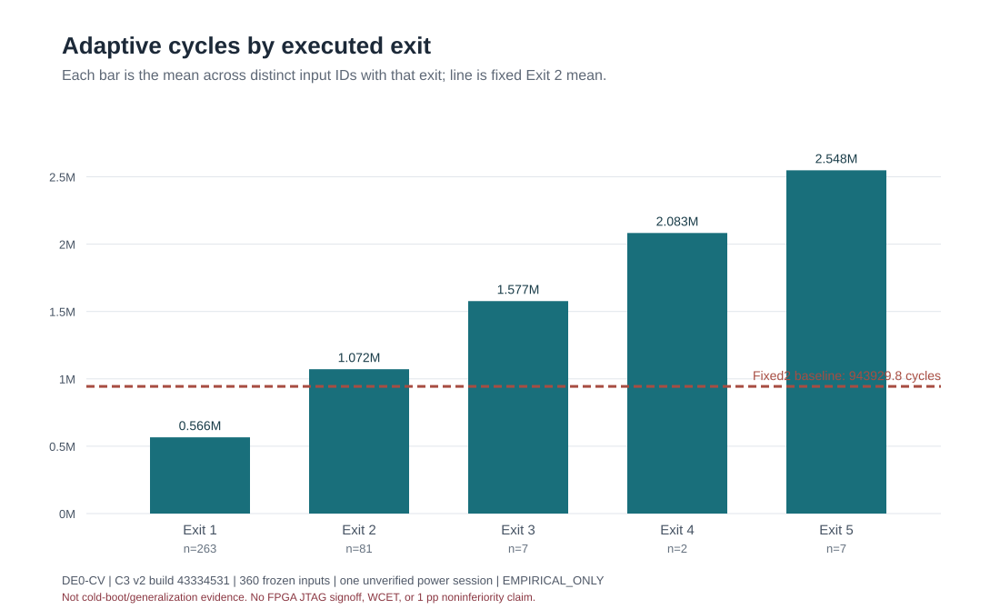

# Resource-Conditioned Neural Inference on a Cyclone V FPGA: An Exact-Build Empirical Case Study

**Working manuscript for technical review — 17 November 2026.** This is a draft of an empirical case study, not a claim of hard-real-time certification. No author names, venue, or accepted-paper status have been assigned.

## Abstract

A neural classifier with conditional early stopping can trade computation for resource availability, but nominal operation counts do not by themselves establish physical latency or worst-case execution-time guarantees. We study a frozen, same-parameter Q15 classifier deployed to an Ibex soft processor on a Terasic DE0-CV Cyclone V FPGA. A continuous normalized budget interface is conservatively mapped to seven finite maximum-work classes; the adaptive policy may stop before its admitted ceiling. We distinguish exact-build measurements from formal physical timing guarantees. In the C3 v2 build, a 64-bit Ibex cycle-counter protocol, model/build identifiers and response checks were used to archive 24,840 successful requests over 13 frozen schedules using 360 distinct held-out inputs. The ten primary schedules contain 3,600 fixed-Exit-2/adaptive input pairs. The fixed and adaptive modes averaged 943,929.77 and 746,327.99 Ibex cycles, respectively: a **20.934% observed mean reduction** (197,601.77 cycles). A 5,000-replicate, input-ID-cluster bootstrap yields a conditional 95% interval of 16.804%–24.903%. The adaptive mode was faster on 263/360 distinct inputs but slower on 97/360; both modes produced 339/360 correct labels. The paired accuracy-difference bootstrap interval of −1.389 to +1.389 percentage points does **not** establish the prespecified one-point noninferiority condition. All ten primary repeats had identical cycle counts for each input/mode, but they are not independently verified power sessions. Moreover, external onboard JTAG I/O timing is unconstrained, and the identified CDC structures retain review findings. Our results establish bounded-scope, exact-build **empirical** cycle savings and correct functional protocol behavior; they do not establish deployment-wide speed superiority, accuracy noninferiority, deadline guarantees, or worst-case execution time (WCET).

**Keywords:** conditional computation; early exiting; Q15; Ibex; FPGA; exact-artifact reproducibility; empirical cycle accounting; real-time systems.

## 1. Introduction

Resource-adaptive neural execution is useful when additional internal computation has diminishing value and available resource or deadline changes at run time. Earlier work on early exits and conditional routing established several ways to reduce expected computation [1–3]. A hardware claim, however, requires distinguishing *executed neural work*, *software/RTL execution cycles*, *I/O transfer latency*, and *a proof of a deadline bound*. An instruction-count approximation, a host-side time percentile, or a positive FPGA internal-clock slack report alone cannot fill these different evidentiary roles.

This study evaluates an exact build of the repository's resource-conditioned RTNN prototype on one Cyclone V board. It uses the same frozen seed-63 Q15 parameter set under a finite maximum-work ceiling, rather than training a separate model for each budget. The key contributions of the present case study are:

1. A 24,840-row empirical JTAG acquisition audit tied to one C3 v2 SOF, one firmware ELF, one model identity, 13 frozen schedules and original raw request/response traces.
2. An independently recomputed, input-paired cycle comparison with explicit *input-level* statistical uncertainty, observed failure modes (late exits), and a separate accuracy-noninferiority verdict.
3. A matched previous-build comparison demonstrating an exact **+5 Ibex-cycle difference for all 7,200 primary rows** while preserving the output prediction and admitted/executed exits.
4. An explicit boundary between empirical function/cycle evidence and incomplete onboard JTAG timing/CDC signoff.

These observations are not offered as an original theorem of universal WCET or as an exhaustive comparison with all adaptive-computation systems.

## 2. System and frozen artifact identity

The target is a Terasic DE0-CV with a Cyclone V **5CEBA4F23C7N**, an Ibex RV32 softcore, and FPGA-resident code/data for the selected build. The observed physical counter is the Ibex `mcycle` CSR, **not** a wall-clock stopwatch. The synthesis/STA design declares a 50 MHz system clock; no measured oscillator calibration or absolute inference-time claim is made. Quartus Prime Lite **25.1std.0 Build 1129** and Verilator-based simulations are recorded in the source evidence.

The same Q15 neural parameters are used under two relevant execution choices: fixed Exit 2 and input-adaptive execution. The public budget admits a maximum-work class; optional neural blocks are not required to run simply because the maximum grant is large. The hardware-protocol response includes prediction, executed class, admitted class, request/response identity, checksums, and 64-bit start/end cycle samples. The timer samples bracket the firmware's inference/admission path and exclude the host's JTAG scan and wait operations.

| Immutable item | C3 v2 primary empirical build |
|---|---|
| Build / binding ID | `43334531` |
| Model ID | `52544e4e` |
| SOF SHA-256 | `85c5fd086cf83c5a897f3de1bba1d3dd0c0a5c06a53eb492a23e5160fb3f1f2d` |
| Firmware ELF SHA-256 | `9cbf537bd9440deaf5c78abf6b204da9cbcd2fe3795acf444d733dbd581002b6` |
| Frozen campaign SHA-256 | `d6c98f59c0c0afe32d0877c01c8411fba8bf3e2a5c8058c5a85371f7f648a8dc` |
| Q15 weight header SHA-256 | `961a76b7e220bf2f665e7c04ab62063600aa2e7eccf3403d80ea730bc993ad9f` |
| Prior C2J2 build / SOF SHA-256 | `43324a32` / `5aa5be2e7387e22e43db6a322e1572cceacd3266231af4dbc2de01ee649c37e6` |

The previous C2J2 build is analyzed only as a **separate frozen-artifact comparator**; no raw rows from its campaign are pooled into C3 v2 estimates.

## 3. Evaluation design and reproducible methods

### 3.1 Frozen schedules and grain

The archived campaign contains **13 schedules / 24,840 requests**: diagnostic fixed 2,520, diagnostic adaptive 7,560, diagnostic capped 7,560, and ten primary schedules × 720 rows = 7,200. The evaluation uses **360 distinct input IDs**, not 24,840 independently sampled images. Each primary schedule includes every ID once under fixed Exit 2 and once under the corresponding adaptive policy. No schedule, target label or model weight was changed for this reanalysis.

For each primary request we checked: exactly one sequence, valid build/SOF/model/binding identity, response-to-request input/mode/sequence identity, CRC, frozen expected prediction and executed/admitted exits, valid positive cycles, and correct 64-bit counter subtraction. The 13-schedule aggregate evidence audit additionally checks all frozen run counts and hashes. A separate C2J2 comparison uses only frozen rows with the same input, mode and primary schedule.

### 3.2 Variables, estimands and unit check

| Symbol | Meaning (日本語) | SI unit | Definition and domain | Type |
|---|---|---|---|---|
| `i` | 凍結評価入力ID | 1 (dimensionless) | integer 0–359; one held-out input | discrete scalar |
| `s` | 凍結primaryスケジュール | 1 | integer 1–10, all within the same unverified power-session context | discrete scalar |
| `N` | 独立評価入力数 | 1 | 360, fixed by the frozen evaluation set | positive integer scalar |
| `C_F,i,s` | 固定Exit 2の実行サイクル数 | 1 (count of cycles) | positive Ibex `mcycle` delta for input `i`, schedule `s` | integer scalar |
| `C_A,i,s` | 適応実行サイクル数 | 1 (count of cycles) | positive Ibex `mcycle` delta for same input/schedule | integer scalar |
| `F_i` / `A_i` | 入力ごとの固定／適応平均cycle | 1 (count of cycles) | average of the ten corresponding primary schedules | real scalar |
| `D_i` | 入力別のcycle削減量 | 1 (count of cycles) | `F_i − A_i`, can be negative | real scalar |
| `R` | 固定平均に対する平均削減比 | 1 (dimensionless) | ratio of mean paired saving to mean fixed cycles | real scalar |
| `Y_i` | 真の分類ラベル | 1 | frozen handwritten-digit class, 0–9 | discrete scalar |
| `P_F,i`, `P_A,i` | 固定／適応の予測ラベル | 1 | frozen classifier prediction, class 0–9 | discrete scalar |

The paired sample estimands are

\[
D_i=F_i-A_i,\qquad
\bar D=\frac{1}{N}\sum_{i=0}^{N-1}D_i,\qquad
R=\frac{\bar D}{\frac{1}{N}\sum_{i=0}^{N-1}F_i}.
\]

**Dimensional check:** both `F_i` and `A_i` are counts of CPU clock cycles (SI dimension 1), hence `D_i` and `\bar D` are also counts; the ratio `R` is dimensionless. No uncalibrated CPU-clock setting was turned into an SI time measurement.

Uncertainty intervals resample the **360 input IDs**, holding the ten planned primary observations together within each ID (Python `random.Random(63)`, 5,000 replicates, linearly interpolated percentile endpoints). They do not resample independent board boots because independent cold boots were **not established**. Accuracy is compared on the same 360 labels, using paired correctness indicators rather than treating repeats as new labels.

## 4. Results

### 4.1 Archive integrity and the empirical cycle contrast

The C3 v2 aggregate archive reports **13/13 successful schedules and 24,840/24,840 requests**, with the response checks passing under the saved source identity. This reanalysis independently parsed all ten primary CSVs (7,200 rows), checked the published per-session SHA-256 values against the aggregate manifest and found no mismatches in required identity, expectation or 64-bit interval fields.

| Primary result | Frozen C3 v2 observation |
|---|---:|
| Unique input IDs / paired schedule observations | 360 / 3,600 |
| Fixed Exit 2 mean | **943,929.77 cycles** |
| Adaptive mean | **746,327.99 cycles** |
| Fixed2 minus adaptive mean | **197,601.77 cycles** |
| Observed mean reduction | **20.93395%** |
| 95% input-only bootstrap CI, absolute saving | **158,616.47 to 235,071.07 cycles** |
| 95% input-only bootstrap CI, reduction | **16.80384% to 24.90345%** |
| Unique inputs faster / slower with adaptive execution | **263 / 97** |
| Primary input-mode pairs with different cycle counts across ten schedules | **0 / 720** |

The 5% practical reduction point estimate and input-only CI threshold are met **conditional on the recorded session**. The original study's independent-power-session requirement is not met, so we explicitly **withhold a confirmatory speed-superiority claim**.


### 4.2 Early stopping saves work for many, but not all, inputs

The adaptive executed Exit histogram over the 360 unique IDs is:

| Executed Exit | Unique inputs | Mean adaptive cycles |
|---:|---:|---:|
| 1 | 263 | 565,955.62 |
| 2 | 81 | 1,071,501.64 |
| 3 | 7 | 1,577,048.14 |
| 4 | 2 | 2,082,594.00 |
| 5 | 7 | 2,547,941.71 |

Fixed Exit 2 averages 943,929.77 cycles. The adaptive policy's late Exit 2–5 cases therefore have higher observed cycles than the fixed-2 baseline in this artifact. A prototype that saves arithmetic on most inputs can nevertheless incur a material tail on hard inputs. This exit-stratified finding is descriptive: it does **not** identify what *caused* the per-image stopping decision.



### 4.3 Accuracy remains a separate unresolved claim

Both configurations classify **339/360 (94.167%)** held-out inputs correctly. The paired contingency is **336 both-correct, 3 fixed-only-correct, 3 adaptive-only-correct and 18 both-wrong**. Their observed accuracy difference is 0.000 percentage points. The input-paired percentile-bootstrap 95% interval is **[−1.389, +1.389] percentage points**. Because its lower bound is below the prespecified −1.0-point noninferiority margin, **1-point accuracy noninferiority is INCONCLUSIVE**, not PASS. Replaying the same 360 inputs cannot close this inferential gap merely by producing more JTAG requests.

### 4.4 A separately identified +5-cycle build difference

We matched all ten primary C2J2 CSVs against the corresponding C3 v2 CSVs by schedule, sequence, input ID and mode. Across **all 7,200** paired rows, the C3 v2 cycle count exceeded C2J2 by **exactly five cycles**, while every prediction, admitted Exit and executed Exit matched. The mean cycle **difference** between fixed and adaptive is consequently unchanged across builds; the fractional reduction changes slightly because both denominators shift.

The C3 v2 firmware explicitly stores a 64-bit `cycles_start` value within the measured boundary, unlike the old C2J2 elapsed-counter response path. This is a **plausible implementation-level contributor** to the constant shift. A cycle-accurate instruction-trace or compiler artifact comparison is still required before attributing all five cycles causally to that store. The five-cycle effect is an **observed cross-build offset, not a universal correction factor**.

### 4.5 Why identical schedule repeats do not establish boot independence

For every input and each execution mode, the `mcycle` delta is exactly identical over all ten primary schedules (360/360 input IDs, both modes). This supports a deterministic cycle path under the saved board/build/session conditions. It does **not** establish ten independent realizations of clock, power-on reset, temperature, placement, or board-to-board variability. A previously attempted power-cycle study left the USB-Blaster connected, making full FPGA rail discharge uncertain. The current C3 v2 schedule metadata explicitly mark `cold_boot_confirmed=false`.

## 5. Implementation, reproducibility and timing-assurance limits

The case study uses a known FPGA SOF, firmware ELF, source hashes and frozen schedule files rather than relying only on a training seed. The C3 v2 compile, native and converted RTL regressions, four-corner internal STA and finite CDC phase-stress tests are archived. Preserved reports include positive worst constrained setup slack (+1.803 ns) and hold slack (+0.124 ns), but **external TDI/TMS/TDO paths are not completely constrained** for the on-board FT245BL/EPM240 USB-Blaster controller. The Quartus Design Assistant still identifies **16 D102 CDC structures**. A finite digital simulation and a bundled-data route-delay screening analysis cannot prove analog metastability immunity, external JTAG sampling validity under all conditions, or WCET.

The stored 146-source native regression has been reproduced in its particular WSL environment, but the clean repository does not independently vendor the **141 pinned Ibex dependency files** used by that graph. Thus a source-graph build is conditionally reproducible with the pinned external checkout, not fully portable from a bare Git checkout. This is a separate remaining reproducibility gate.

We therefore distinguish:

- **PASS, recorded empirical data integrity:** run IDs, source identities, 64-bit counter differences, frozen predictions and executed exits for the audited archive.
- **Conditional numerical summary:** input-level saving under the observed single-board/session context.
- **INCONCLUSIVE accuracy noninferiority:** the prespecified 1-point margin is not established.
- **UNCERTAIN independent boot variability:** independent full power sessions were not verified.
- **BLOCKED formal board timing signoff:** external on-board JTAG timing constraints and complete CDC assurance are missing.

The reported finite counts are not thermal/power measurements, wall-clock latency, energy efficiency, or a theorem of hard deadline feasibility.

## 6. Conclusion and prioritized validation plan

For one identified DE0-CV/soft-Ibex/Q15 build, resource-conditioned computation empirically saved **20.934% mean inference cycles** relative to fixed Exit 2 over 360 frozen held-out inputs, with positive saving for 263 inputs and increased cost for 97. It retained the same aggregate correct-label count, while not establishing the prespecified 1-point noninferiority bound. The complete 24,840-row trace packet supports an exact-artifact case study, not a cross-board timing certificate.

The most valuable follow-up is to secure reproducible independent power sessions and a larger, prospectively frozen held-out sample if the authors seek confirmatory speed or accuracy claims. Formal board-level timing assurance should be treated as a separate research gate requiring board-specific controller timing data and defensible measurement uncertainty; no oscilloscope should be connected without verified safe probe points. For the present work, manuscript/evidence consistency and a portable source dependency manifest take precedence over repeating the same uninformative measurement.

## Evidence and reproducibility

The primary evidence is internal to the publicly readable repository:
- [C3 v2 full campaign run record](../evidence/PHYSICAL_C3_V2_20261115/FROZEN_CAMPAIGN/RUN_RECORD_JA.md)
- [C3 v2 aggregate run audit](../evidence/PHYSICAL_C3_V2_20261115/FROZEN_CAMPAIGN/C3V2_CAMPAIGN_AGGREGATE_AUDIT_20261115.json)
- [Prior C2J2 historical campaign](../C3_FULL_CAMPAIGN_RUN_RECORD_JA.md)
- [Source/readiness limitations](../C3_CURRENT_STATUS_20261115_OFFLINE_COMPLETION_JA.md)
- [C3 v2 firmware runner](../source/measurement_protocol_v2_43334531_20261115/firmware/rtnn_experiment_runner.c)
- [C2J2 firmware runner](../source/recovered_c2_firmware_43324a32_20261115/firmware/rtnn_experiment_runner.c)

Run this repository-contained, standard-library-only analysis with a new output directory:

```bash
python3 artifacts/experiments/de0_cv_c1_c2_audit_20261114/C3/paper_20261117/reanalyze_c3v2_primary.py --out-dir /tmp/rtnn-c3v2-paper-repro-unique
```

The script checks the 13-schedule manifest totals, hashes all ten C3 v2 primary CSVs, parses their 7,200 result rows, validates 64-bit counter differences and Q15 reference fields, matches 7,200 old-build comparison rows, and writes input-level data, figures and analysis with a SHA-256 manifest. No board, Quartus, Internet, root privileges or statistical third-party packages are required once the source repository has been obtained. The frozen source data are not modified.

## References

1. S. Teerapittayanon, B. McDanel, H. T. Kung. "BranchyNet: Fast Inference via Early Exiting from Deep Neural Networks." *International Conference on Pattern Recognition* (ICPR), 2016. DOI: [10.1109/ICPR.2016.7900006](https://doi.org/10.1109/ICPR.2016.7900006); arXiv: [1709.01686](https://arxiv.org/abs/1709.01686).
2. G. Huang, D. Chen, T. Li, F. Wu, L. van der Maaten, K. Q. Weinberger. "Multi-Scale Dense Networks for Resource Efficient Image Classification." *International Conference on Learning Representations* (ICLR), 2018. arXiv: [1703.09844](https://arxiv.org/abs/1703.09844).
3. X. Wang, F. Yu, Z.-Y. Dou, T. Darrell, J. E. Gonzalez. "SkipNet: Learning Dynamic Routing in Convolutional Networks." *European Conference on Computer Vision* (ECCV), 2018. arXiv: [1711.09485](https://arxiv.org/abs/1711.09485).

**Review status:** Numerical claims and archive identities in Sections 3–4 are subject to the included, executable independent reanalysis. This draft is **not publication-ready until the paper's claimed scope, all source links, data license/citation, and coauthor-approved interpretation are reviewed**.
