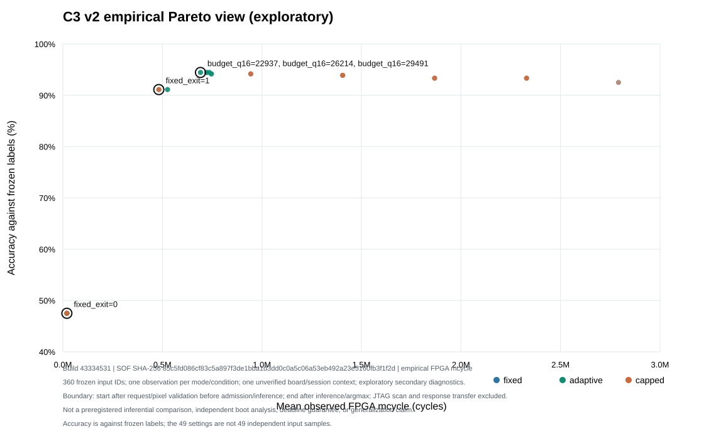

# 保存済みC3 v2実測のPareto解析

## 対象と再現方法

Build `43334531`、SOF SHA-256 `85c5fd086cf83c5a897f3de1bba1d3dd0c0a5c06a53eb492a23e5160fb3f1f2d`、campaign SHA-256 `d6c98f59c0c0afe32d0877c01c8411fba8bf3e2a5c8058c5a85371f7f648a8dc` の保存済みdiagnostic CSVだけを使用した。3つのCSV（fixed 2,520行、adaptive 7,560行、capped 7,560行）についてSHA、identity、CRC、prediction、cap、64-bit mcycle区間、入力IDと条件の重複・欠損をスクリプトで検査した。全条件に同じ360凍結入力が1回ずつ含まれる。

再実行：

```powershell
python .\analyze_pareto_frontier_v2.py --out-dir .\pareto_input_audit_run3
python .\analyze_pareto_frontier_v2.py --out-dir .\pareto_input_audit_run4
```

final script v2の2出力は、全7出力を記載した`SHA256SUMS.txt`で一致した。`PARETO_INPUT_LEVEL.csv`は17,640個の入力×条件結果、`PARETO_FIXED2_PAIRWISE.csv`は適応21予算×360入力のfixed Exit 2対応差、`PARETO_BUDGET_ACCURACY_NONMONOTONIC.csv`は隣接する予算増加で正答数が増えない区間と正誤が入れ替わる入力IDを出力する。`PARETO_POINTS.csv`は49条件の支配関係、JSONは各条件の実行Exit分布・全入力ID別の集計を含む。`pareto_input_audit_run1/2`は最終Exit別内訳の追加前の中間版として残す。既存のprimary検定や元CSVは変更していない。

## 結果

サイクルを小さく、凍結教師ラベルに対するaccuracyを高くする49条件（fixed 7、adaptive 21、capped 21）を比較した。非支配点は重複する同一座標を統合すると3点だった。

| Pareto点 | 条件 | Accuracy | 平均cycle |
|---|---|---:|---:|
| 1 | 固定Exit 0 | 47.500% (171/360) | 20,152.911 |
| 2 | 固定Exit 1 | 91.111% (328/360) | 482,039.636 |
| 3 | adaptive予算Q0.16=22,937 / 26,214 / 29,491 | 94.444% (340/360) | 691,343.072 |

この同一sample上では、固定Exit 2とすべてのcapped条件は少なくとも1条件に支配された。最大予算adaptive条件も、より低い予算で同じか高いaccuracyかつ少ないcycleを得たdiagnostic条件に支配された。これは予算曲線とトレードオフを記述する探索的結果であり、一次の事前登録済みfixed2対adaptive比較を置き換えない。

診断入力IDは学習データから独立した360-IDの凍結集合ではあるが、今回の複数条件・比較対象・Pareto点は同じ評価集合に基づく。さらに、固定Exit 2 comparatorの選択には過去のtest結果が知られていた。したがってPareto前線の最大accuracy点や選択後の速度を新しい汎化性能・独立確認と解釈してはならない。統計上の360入力を独立標本として扱う推論であって、独立cold-boot変動を表さない。

## 入力ごとの遅いケースと正答数の非単調性

`PARETO_FIXED2_PAIRWISE.csv`で各adaptive条件を同一input IDの固定Exit 2結果と直接対応させた。最大budget Q0.16=65,535では263 IDでadaptiveが速く、97 IDで遅く、同サイクルは0 IDだった。遅い97件は実行Exit別にExit 2が81件、Exit 3が7件、Exit 4が2件、Exit 5が7件。これは特定buildの計測内での比較であり、独立セッションの効果ではない。予算22,937/26,214/29,491でも遅いID数は97で、全件がExit 2だった。予算32,768ではExit 3まで進む遅いIDが16件に増えた。

`PARETO_BUDGET_ACCURACY_NONMONOTONIC.csv`はadaptive/cappedごとの20隣接予算区間について、正答数が増えない区間と入れ替わったIDをすべて列挙する。adaptiveは18/20区間で非増加（17区間は同数、1区間は減少）、cappedは18/20（15区間は同数、3区間は減少）だった。減少例はadaptiveの52,428→55,705で340→339（ID 251が正答から誤答へ）、cappedの29,491→32,768で339→338（4件が正答から誤答、3件が誤答から正答）、42,598→45,874で338→336、62,258→65,535で336→333。すべて同じ凍結360入力上の事後的な記述で、追加計算が一般に精度を下げるという因果主張ではない。

最終入力別出力は`pareto_input_audit_run3/`と`pareto_input_audit_run4/`に保存し、両runの`SHA256SUMS.txt`が一致した。中間の`pareto_input_audit_run1/2/`はExit別の遅い入力内訳を追加する前の出力で、履歴保全のため残している。最終スクリプトは`analyze_pareto_frontier_v2.py`。



## 位置付け

これは経験的・探索的なPareto記述である。精度非劣性はINCONCLUSIVE、cold-boot感度はUNCERTAIN、正式タイミング保証とWCETは未成立のまま維持する。時間単位はibex `mcycle` countで、校正済み秒やppmを推定しない。
